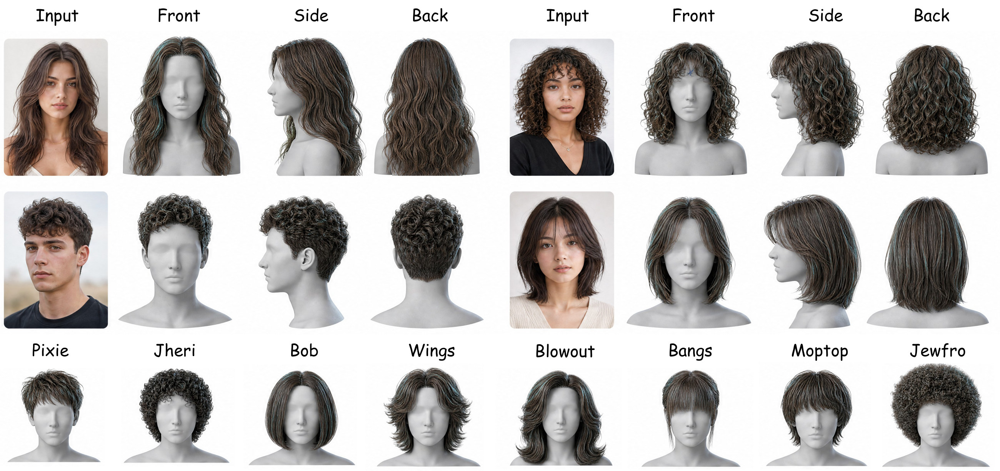
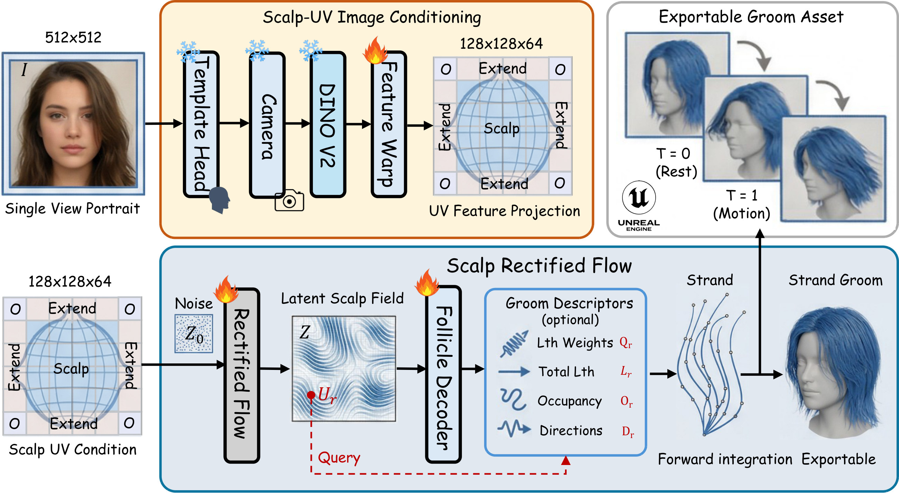
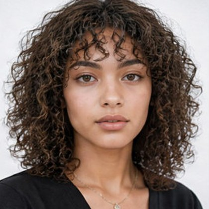
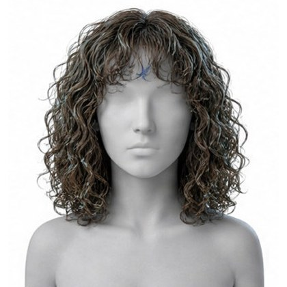
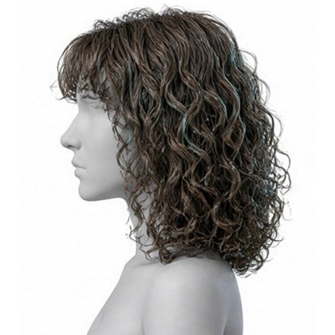
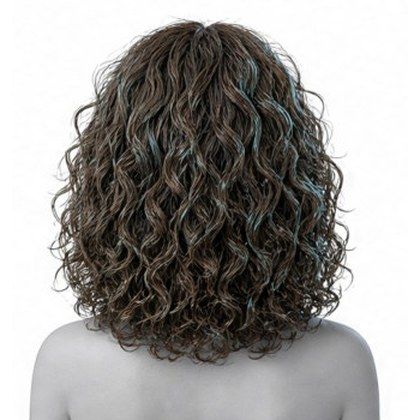
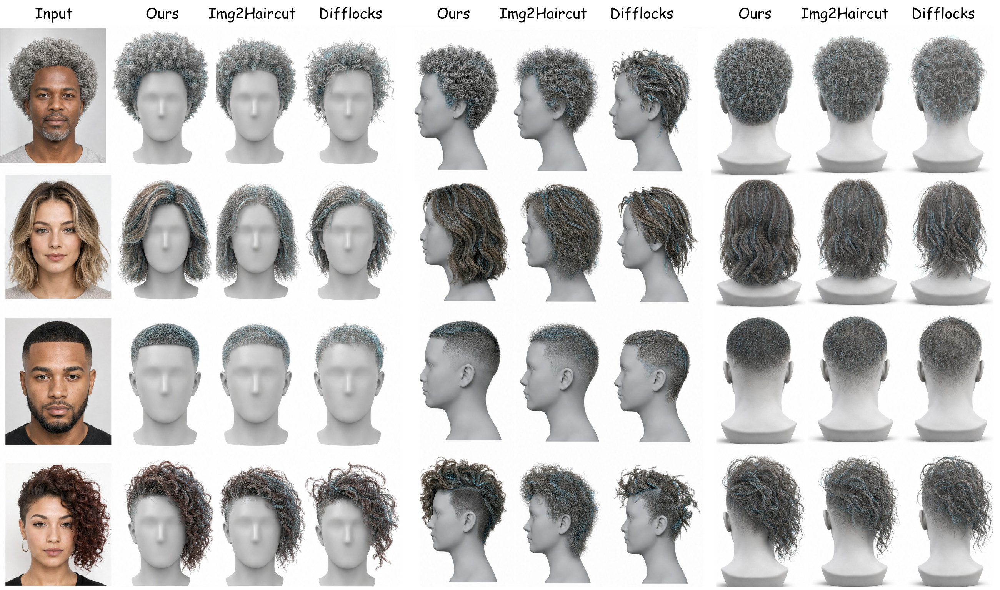
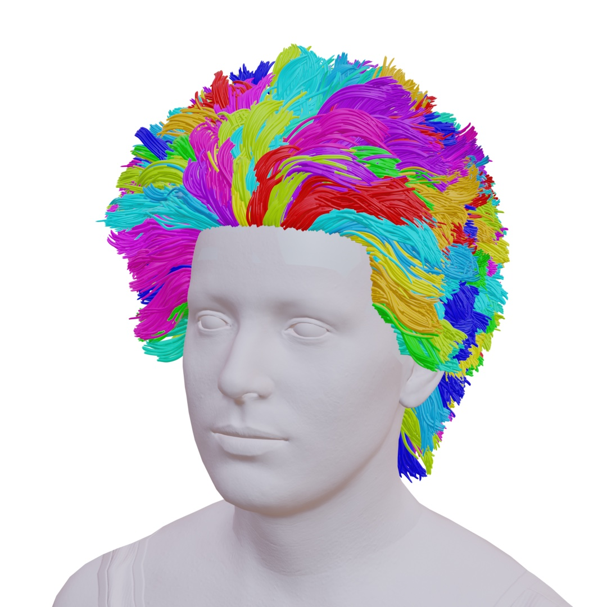
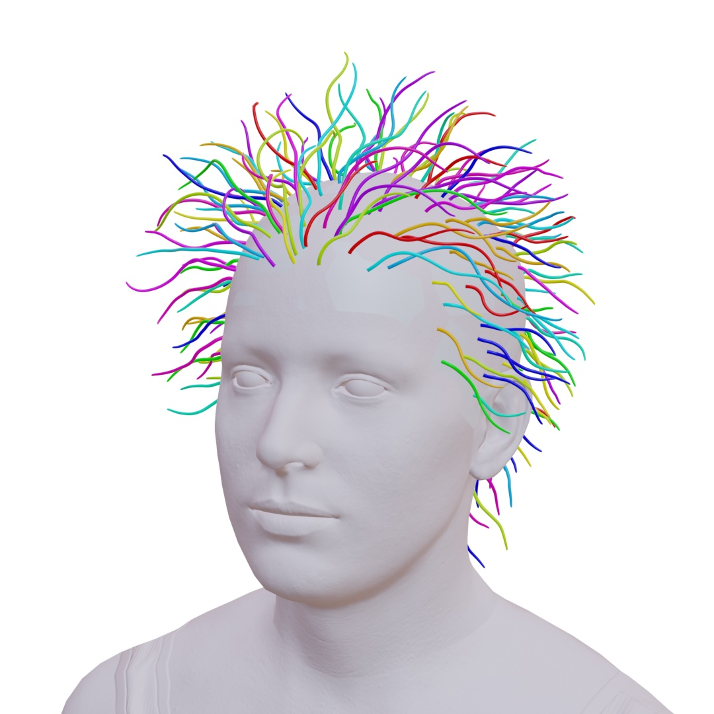
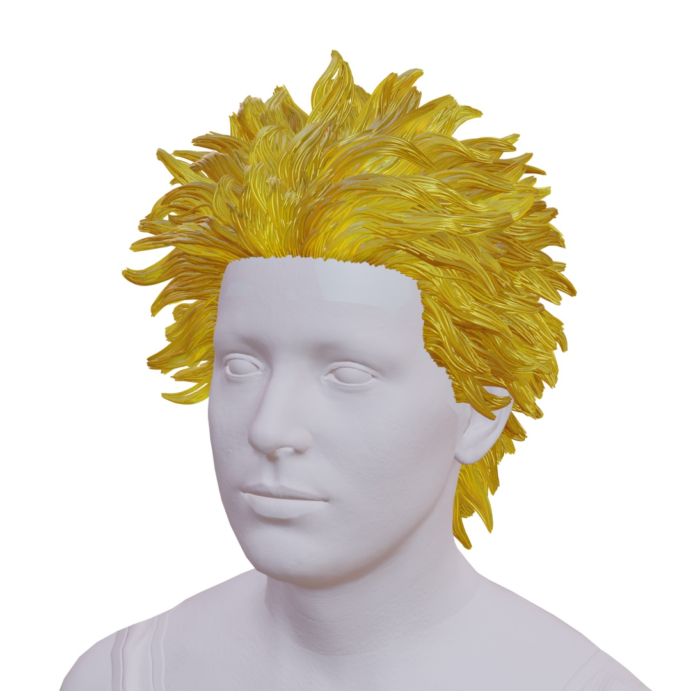

<div align="center">

<h1>SAFE-Hair</h1>

<h3>Scalp-Anchored Fields for Exportable Single-View 3D Hair Reconstruction</h3>

<p><b>NeurIPS 2026</b></p>

<p>
<a href="https://wangandyyucheng.github.io/">Yucheng Wang</a><sup>1</sup> &nbsp;·&nbsp;
<a href="https://jacky1128.github.io/">Zedong Wang</a><sup>1</sup> &nbsp;·&nbsp;
<a href="https://scholar.google.com/citations?user=Fjqr0fEAAAAJ">Yuetong Wu</a><sup>1</sup> &nbsp;·&nbsp;
<a href="https://mayuelala.github.io/">Yue Ma</a><sup>1</sup> &nbsp;·&nbsp;
<a href="https://www.danxurgb.net/">Dan Xu</a><sup>1&dagger;</sup>
</p>

<p><sup>1</sup>The Hong Kong University of Science and Technology &nbsp;&nbsp; <sup>&dagger;</sup>Corresponding author</p>

<p>
<a href="https://safe-hair.github.io/"></a>
<a href="https://arxiv.org/"></a>
<a href="#"></a>
<a href="#release-plan"></a>
</p>



</div>

<br>

> **TL;DR** &nbsp; Instead of predicting unordered strands in image or world space, SAFE-Hair reasons in a **canonical scalp-UV domain**
> shared by all subjects and decodes one strand per persistent follicle. The result is a groom that can be edited, simulated and
> exported straight into production tools.

## 🔍 Method

<div align="center">

</div>

<table>
<tr>
<td width="25%" valign="top"><b>① Scalp-UV conditioning</b><br><sub>Fit a template head, extract DINOv2 features and warp them onto the scalp through the recovered camera.</sub></td>
<td width="25%" valign="top"><b>② Rectified flow</b><br><sub>Transport noise to a latent scalp field <i>Z</i> ∈ ℝ<sup>128×128×64</sup>, completing regions the portrait never shows.</sub></td>
<td width="25%" valign="top"><b>③ Follicle decoding</b><br><sub>Query <i>Z</i> at canonical follicles and grow each strand from its fixed root by forward integration.</sub></td>
<td width="25%" valign="top"><b>④ Validity priors & export</b><br><sub>Attachment, collision and bending priors; strands grouped into guide families for Alembic or engine grooms.</sub></td>
</tr>
</table>

## 🖼️ One Portrait, Every View

<table>
<tr>
<td align="center" width="25%"><br><sub><b>Input</b> · one front-facing portrait</sub></td>
<td align="center" width="25%"><br><sub><b>Front</b> · reconstructed groom</sub></td>
<td align="center" width="25%"><br><sub><b>Side</b> · never seen in the input</sub></td>
<td align="center" width="25%"><br><sub><b>Back</b> · completed by learned priors</sub></td>
</tr>
</table>

### Comparison with Im2Haircut and DiffLocks

<div align="center">

<p><sub>Front, side and back views for four portraits. Each block shows <b>SAFE-Hair</b> first, then Im2Haircut and DiffLocks.</sub></p>
</div>

## 📊 Quantitative Results

<details open>
<summary><b>Geometry on HairBench-3D</b></summary>
<br>

| Method | ChamferPts ↓ | F-score ↑ | F-score (Invis.) ↑ | IoU ↑ | Pen. ratio ↓ |
| :-- | :-: | :-: | :-: | :-: | :-: |
| Perm | 5.82 | 61.4 | 42.7 | 0.781 | 8.6 |
| NeuralHDHair | 4.36 | 71.8 | 56.2 | 0.824 | 6.1 |
| Hairstep | 4.48 | 70.6 | 59.4 | 0.872 | 7.2 |
| DiffLocks | 3.91 | 76.5 | 63.8 | 0.847 | 5.4 |
| Im2Haircut | <ins>3.74</ins> | <ins>77.9</ins> | <ins>66.1</ins> | 0.861 | <ins>4.8</ins> |
| **SAFE-Hair (ours)** | **3.28** | **81.7** | **69.8** | **0.884** | **3.9** |

</details>

<details>
<summary><b>Asset usability</b></summary>
<br>

| Method | RootDist ↓ | ValidRoot ↑ | FollicleStab. ↑ | ExportSucc. ↑ |
| :-- | :-: | :-: | :-: | :-: |
| Perm | – | – | – | – |
| NeuralHDHair | 3.8 | 82.1 | – | 71.3 |
| Hairstep | 2.9 | 87.4 | – | 76.8 |
| DiffLocks | 2.4 | 89.6 | 0.61<sup>†</sup> | 82.5 |
| Im2Haircut | <ins>1.7</ins> | <ins>93.2</ins> | <ins>0.68</ins><sup>†</sup> | <ins>88.1</ins> |
| **SAFE-Hair (ours)** | **0.2** | **99.8** | **0.91** | **99.6** |

<sub>RootDist: mean root-to-scalp distance (mm). ValidRoot: % of roots on a valid scalp region. FollicleStab.: active-follicle
consistency under crop, colour and mask perturbations. ExportSucc.: % of predictions serialisable as valid grooms.
<sup>†</sup>Approximated by nearest-root matching.</sub>

</details>

## 💇 Exportable Groom

<table>
<tr>
<td align="center" width="33%"><br><sub><b>(a)</b> Guide-family clusters</sub></td>
<td align="center" width="33%"><br><sub><b>(b)</b> Guide strands</sub></td>
<td align="center" width="33%"><br><sub><b>(c)</b> Refined groom</sub></td>
</tr>
</table>

Each strand's identity is simply its follicle index. Follicles are grouped into guide families, and the groom serialises
straight into Alembic or engine-native strand assets without changing the reconstructed geometry.

## 🗓️ Release Plan

- [x] Project page
- [ ] Paper on arXiv
- [ ] Inference code and pretrained checkpoints
- [ ] Groom export tools
- [ ] HairBench-3D evaluation
- [ ] Training code

⭐ Star or watch this repository to get notified when the code is released.

## 📝 Citation

```bibtex
@inproceedings{wang2026safehair,
  title     = {SAFE-Hair: Scalp-Anchored Fields for Exportable
               Single-View 3D Hair Reconstruction},
  author    = {Wang, Yucheng and Wang, Zedong and Wu, Yuetong
               and Ma, Yue and Xu, Dan},
  booktitle = {Advances in Neural Information Processing Systems (NeurIPS)},
  year      = {2026}
}
```

## 🙏 Acknowledgements

We thank the authors of the following works for releasing their code and models:

- **DINOv2**: Learning Robust Visual Features without Supervision.
  Oquab et al. *TMLR 2024*. [[Code]](https://github.com/facebookresearch/dinov2)
- **DiffLocks**: Generating 3D Hair from a Single Image using Diffusion Models.
  Rosu, Wu, Feng, Zheng and Black. *CVPR 2025*. [[Project]](https://radualexandru.github.io/difflocks/) [[Code]](https://github.com/Meshcapade/difflocks)
- **Im2Haircut**: Single-view Strand-based Hair Reconstruction for Human Avatars.
  Sklyarova, Zakharov, Prinzler, Becherini, Black and Thies. *ICCV 2025*. [[Project]](https://im2haircut.is.tue.mpg.de/) [[Code]](https://github.com/Vanessik/Im2Haircut)
